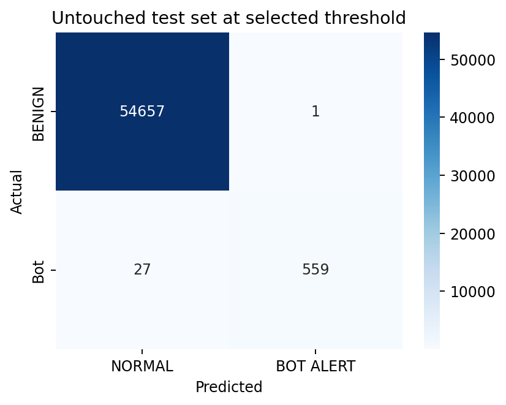
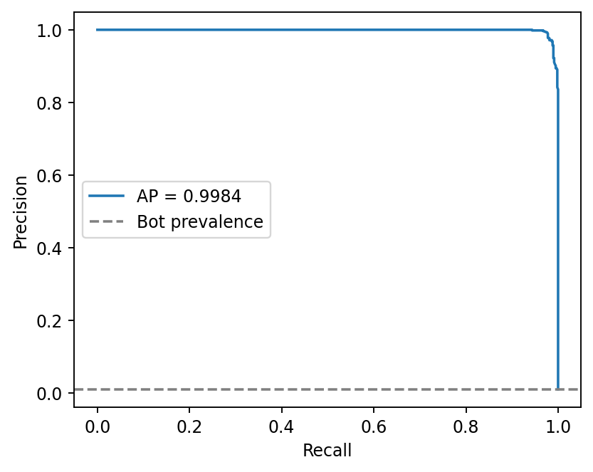

# 🔎 Botnet Detection IDS Lab

A cybersecurity coursework project that classifies BENIGN and Bot
network flows using machine learning on the Friday morning subset
of CICIDS2017.

The project covers data exploration, preprocessing, feature selection,
class imbalance handling, model comparison, threshold selection,
and false-positive / false-negative analysis.

**Technologies:** Python · pandas · scikit-learn · Matplotlib · Jupyter

[Read the report](report.pdf)
· [Explore the notebook](notebook/ids_botnet_detection.ipynb)
· [View experiment results](results/)

## Project Overview

The goal is to evaluate botnet detection on a labelled network-flow
dataset and understand the trade-off between detecting attacks
and generating false alarms.

This is an offline learning experiment using CSV flow features.
It does not capture live network packets.

Reports and notebook explanations are written in Vietnamese.

## My Contribution

This is an individual coursework project. I completed the
data analysis, preprocessing, model comparison, threshold selection,
evaluation, and report preparation.

The experiment uses the dataset and requirements provided
for the coursework.

## Methodology

1. Remove duplicate records before splitting the data.
2. Exclude IP addresses, Flow ID, and Timestamp from predictors.
3. Use stratified development / validation / test splits
   of approximately 56% / 14% / 30%.
4. Fit preprocessing, feature selection, and SMOTE on development
   data, repeating these steps within cross-validation folds.
5. Compare candidate models and select the model and decision
   threshold using validation data.
6. Evaluate the selected configuration on the held-out test set
   and review misclassified flows.

## Selected Configuration and Test Results

**Model:** Random Forest with SMOTE  
**Decision threshold:** 0.90  
**Positive class:** Bot

The configuration was selected on validation data by requiring
recall of at least 95%, then prioritizing precision.

| Metric | Held-out test result |
|---|---:|
| Precision | 99.82% |
| Recall | 95.39% |
| F1-score | 97.56% |
| Average Precision (AP) | 0.99843 |
| True positives | 559 |
| False positives | 1 |
| False negatives | 27 |
| True negatives | 54,657 |

Source: [Saved configuration and metrics](model/threshold.json).

These values use the selected threshold of 0.90. The model comparison
table contains results at a different operating threshold and should
be read separately.

### Confusion Matrix



### Precision–Recall Curve



## Limitations

- Results apply only to an internal split of the supplied Friday
  morning dataset.
- Generalization across hosts, time periods, and external datasets
  has not been evaluated.
- Synthetic SMOTE samples may contain fractional values for ports
  or other discrete features.
- CSV replay demonstrates inference on recorded flows, not a
  deployed real-time IDS.

## Mở kết quả

- Đọc `report.pdf` trước.
- Mở `notebook/ids_botnet_detection.ipynb` bằng Jupyter hoặc VS Code.
- Kết quả thực đo ở `results/`, các hình ở `figures/`.
- Mô hình đã fit ở `model/ids_model.joblib`; cấu hình vận hành ở `model/threshold.json`.
- `results/false_positive.csv` và `false_negative.csv` giữ cột gốc để điều tra.

## Chạy lại trên Windows

Nên dùng Python 3.12 trong môi trường riêng; chạy từ thư mục CE181900_Chapter9_IDS.
CSV gốc không được nhân bản trong ZIP. Tạo `data/` và chép CSV gốc vào đó.

```powershell
py -3.12 -m venv .venv
.venv\Scripts\python.exe -m pip install -r requirements.txt
.venv\Scripts\python.exe source\ids_botnet_detection.py --csv "data\Friday-WorkingHours-Morning.pcap_ISCX.csv" --output .
.venv\Scripts\python.exe source\generate_report.py
.venv\Scripts\python.exe -m jupyterlab notebook\ids_botnet_detection.ipynb
```

Linux/macOS: dùng `python3 -m venv .venv`, `.venv/bin/python` và dấu `/`.
Huấn luyện và GridSearchCV chạy trên toàn bộ dữ liệu đã làm sạch, có thể mất vài phút hoặc lâu hơn tùy máy.
Script dùng n_jobs=1 và cache RFE theo fold trong `.ids_cv_cache` cạnh thư mục output.
Có thể xóa cache sau khi chạy; cache không nằm trong ZIP nộp bài.

## Dự đoán flow khác

CSV mới phải có đủ các numerical predictor như `feature_columns` trong threshold.json.
Có thể có thêm Label và cột định danh; chúng không được dùng làm predictor.

```powershell
.venv\Scripts\python.exe source\stream_inference.py --csv "data\new_flows.csv" --output flow_predictions.csv
```

Script kiểm tra cột, xử lý Infinity/NaN, gọi pipeline đã lưu và dùng đúng threshold JSON.
Không phải phần mềm bắt gói tin trực tiếp; dữ liệu đầu vào cần được trích xuất theo schema CICFlowMeter tương ứng.
Chỉ nạp file joblib đáng tin cậy và dùng phiên bản scikit-learn tương thích (requirements.txt).

## Quy tắc tránh leakage

1. Loại bản ghi trùng trước chia tập; không dùng IP, Flow ID hoặc Timestamp làm predictor.
2. Chia ngoài 70/30 bằng stratify và random_state=42.
3. Trong training70, tách validation 20%: development56 / validation14 / test30.
4. Fit preprocessing/RFE/SMOTE trên development; CV fit lại từng bước trong từng fold.
5. Chọn model và threshold trên validation, giữ nguyên model để đánh giá test.
6. Bảng threshold test chỉ để mô tả sau lựa chọn, không dùng để tối ưu lại threshold.

## Các tệp bổ sung

- data_schema.csv: tên cột, kiểu dữ liệu, missing và infinite.
- split_manifest.csv: nguồn dòng và phân vùng để tái kiểm tra.
- feature_selection.csv: Feature / Selected / Rank, bao gồm feature hằng.
- high_correlation_pairs.csv: các cặp |r| > 0.90 trên development.
- scaling_comparison.csv và scaler_validation_metrics.csv: so sánh hai scaler.
- gridsearch_results.csv, tuning.json: 8 cấu hình x 3 fold và best parameters.
- validation_thresholds_all_models.csv: chọn trong 7 mô hình x 9 threshold.
- error_review_10_samples.csv: FN thật; nếu FN ít hơn 10, bổ sung TP ghi nhãn rõ ràng.
- streaming_inference.csv: replay 10 flow test thật, không phải live capture.
- verification.json: kiểm tra artifact, confusion matrix, threshold, split và inference.

SMOTE được triển khai bằng sklearn NearestNeighbors, không cần imbalanced-learn.
Các giá trị tổng hợp cho port/biến rời rạc có thể là phân số; hạn chế được trình bày trong báo cáo.
PR-AUC được định nghĩa là Average Precision (AP).
Mọi kết luận chỉ áp dụng cho phép thử nội bộ file này; chưa kiểm định theo host, thời gian hay dataset ngoài.
